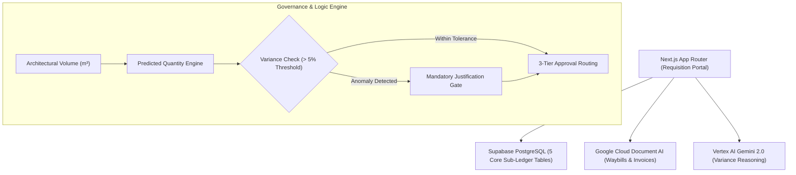

# Project Context & Living Architectural Ledger

**Repository**: `spfdemoapp`  
**Domain Scope**: Afik Group (Caesar Projects) Construction Material Purchasing Sub-Ledger  
**Active Baseline**: `v1.2.0-core-engine`  
**Last Updated**: 2026-10-26  

---

## 1. System Vision & Architecture

The **Afik Group Construction Material Purchasing Sub-Ledger** is an enterprise-grade material requisition, predictive volume verification, and multi-tier governance platform designed for high-density luxury residential developments (specifically Caesar Resort & Spa).

### Core Technology Stack
- **Frontend / Application Framework**: Next.js (App Router) + React 19 + TypeScript (Strict Mode)
- **Styling & UI Design**: Tailwind CSS v4 + Lucide React + Glassmorphism aesthetic tokens
- **Persistence & Cloud Database**: Supabase Cloud PostgreSQL with Row-Level Security (RLS)
- **Document Processing**: Google Cloud Document AI (Receipt, Invoice, and Delivery Note OCR)
- **Cognitive & Analytical Synthesis**: Vertex AI / Google GenAI Gemini 2.0 (Multimodal anomaly justification analysis and automated compliance verification)

---

## 2. Master Data Entities & Database Schema Definitions

The platform anchors directly to five primary Supabase PostgreSQL relational tables:

### 1. `material_catalog`
Stores master specifications, pricing, and structural consumption formulas:
- `item_id` (`UUID`, Primary Key)
- `item_name_tr` (`VARCHAR`, Turkish catalog name, e.g., *C30 Hazır Beton*)
- `item_name_en` (`VARCHAR`, English catalog name, e.g., *C30 Ready-Mix Concrete*)
- `unit_of_measure` (`VARCHAR`, e.g., `m3`, `ton`, `m2`, `pcs`)
- `category` (`VARCHAR`, e.g., `CONCRETE`, `STEEL`, `MASONRY`, `FINISHES`, `PLUMBING`, `ELECTRICAL`)
- `base_cost_eur` (`NUMERIC(12,2)`, Contracted unit price in EUR)
- `consumption_rate` (`NUMERIC(10,4)`, Standard engineering consumption factor per volume metric)
- `consumption_metric` (`VARCHAR`, Formula descriptor, e.g., *m3 of reinforced frame*)

### 2. `projects` & `construction_blocks`
Hierarchical construction site mapping for Caesar Projects:
- Projects: **Caesar Resort & Spa**
- Construction Blocks:
  - `ZENO` (High-rise residential block)
  - `PHUKET` (Resort villa & residential cluster)
  - `PATTAYA` (Mid-rise luxury apartments)
  - `KOH SAMUI` (Commercial & amenities complex)

### 3. `corporate_users`
Role-based access hierarchy governing operational and financial authorities:
- `user_id` (`UUID`, Primary Key)
- `name` (`VARCHAR`)
- `email` (`VARCHAR`)
- `role` (`ENUM`):
  - `FOREMAN`: Site level; initiates purchase requisitions based on architectural progress.
  - `PURCHASING_MGR`: Commercial review; verifies vendor pricing and availability (Tier 1).
  - `PROJECT_DIRECTOR`: Technical and operational audit; approves high-value requisitions (Tier 2).
  - `EXECUTIVE`: Board level; final financial sign-off for critical volume outlays (Tier 3).

### 4. `purchase_requisitions`
The central transaction table recording material requests:
- `ticket_id` (`UUID`, Primary Key)
- `requisition_number` (`VARCHAR`, Format: `REQ-YYYYMM-XXXX`)
- `project_id` (`UUID`, Foreign Key &rarr; `projects.id`)
- `block_id` (`UUID`, Foreign Key &rarr; `construction_blocks.id`)
- `item_id` (`UUID`, Foreign Key &rarr; `material_catalog.item_id`)
- `foreman_id` (`UUID`, Foreign Key &rarr; `corporate_users.user_id`)
- `architectural_volume` (`NUMERIC(12,3)`, Active construction volume in unit metric)
- `predicted_quantity` (`NUMERIC(12,3)`, Algorithmic baseline)
- `requested_quantity` (`NUMERIC(12,3)`, Field requested quantity)
- `variance_percentage` (`NUMERIC(6,2)`, Delta vs. predicted)
- `variance_justification` (`TEXT`, Mandatory when variance &gt; +5%)
- `estimated_total_eur` (`NUMERIC(14,2)`, `requested_quantity * base_cost_eur`)
- `approval_tier` (`INT`, `1`, `2`, or `3`)
- `status` (`ENUM`):
  - `PENDING_PURCHASING`
  - `PENDING_TIER2`
  - `PENDING_TIER3`
  - `APPROVED`
  - `ORDER_PLACED`
  - `DELIVERED`
  - `REJECTED`

### 5. `requisition_approvals`
Immutable audit log tracking every decision step:
- `approval_id` (`UUID`, Primary Key)
- `ticket_id` (`UUID`, Foreign Key &rarr; `purchase_requisitions.ticket_id`)
- `approver_id` (`UUID`, Foreign Key &rarr; `corporate_users.user_id`)
- `approver_role` (`VARCHAR`)
- `action` (`ENUM`: `APPROVED`, `REJECTED`, `ESCALATED`)
- `tier` (`INT`)
- `comments` (`TEXT`)
- `timestamp` (`TIMESTAMPTZ`)

---

## 3. Business Logic Invariants & Predictive Equations

### A. Baseline Prediction Formula
$$\text{predicted\_quantity} = \text{architectural\_volume} \times \text{consumption\_rate}$$

### B. Variance Anomaly Trigger
$$\text{Variance \%} = \left(\frac{\text{requested\_quantity} - \text{predicted\_quantity}}{\text{predicted\_quantity}}\right) \times 100$$
- If $\text{requested\_quantity} > \text{predicted\_quantity} \times 1.05$ (exceeds 5% tolerance):
  1. The UI flags the ticket with an amber **Variance Anomaly** badge.
  2. The submission form enforces a mandatory, validated `variance_justification` (e.g., ground condition settling, structural reinforcement revision, spillage allowance).
  3. Vertex AI Gemini analyzes the justification text against past site incident logs for plausibility.

### C. 3-Tier Approval Routing Hierarchy
The approval workflow is determined by the total estimated requisition value in EUR:

| Tier | Monetary Value Threshold | Required Approver | Governance Scope |
| :---: | :---: | :---: | :--- |
| **Tier 1** | $< \text{€}2,500$ | `PURCHASING_MGR` | Standard stock refills, consumables, minor structural items |
| **Tier 2** | $\text{€}2,500 \text{ to } \text{€}15,000$ | `PROJECT_DIRECTOR` | Significant structural batches (concrete pours, rebar batches) |
| **Tier 3** | $> \text{€}15,000$ | `EXECUTIVE` | Major contract milestones, bulk procurement orders |

---

## 4. Chronological Changelog & Evolution Ledger

### `v1.0.0-init` (2026-10-26)
- Initial repository setup bootstrapped with Next.js App Router and Tailwind CSS v4.
- Integration of `@supabase/supabase-js`, `@google-cloud/documentai`, `@google/genai`, and `lucide-react`.
- Baseline environment configuration and verification in `.env.local`.
- Initial headless compilation pass (`npx tsc --noEmit` -> Exit 0).

### `v1.1.0-dashboard` (2026-10-26)
- Scaffolding of luxury dark/light dashboard presentation components.
- Implementation of KPI overview, document ingestion dropzone, processing pipeline, and drawer viewer.
- Lint and type cleanup: AppleDouble `._*` resource fork exclusion in `eslint.config.mjs`, zero TypeScript and ESLint errors.

### `v1.2.0-core-engine` (2026-10-26)
- Realigned application domain from generic finance to **Afik Group (Caesar Projects) Construction Material Purchasing Sub-Ledger**.
- Formalized five core Supabase relational schemas in [PROJECT_CONTEXT.md](file:///Volumes/Essensials/spfdemoapp/PROJECT_CONTEXT.md).
- Scaffolded strict TypeScript interfaces and predictive domain algorithms in [types/requisition.ts](file:///Volumes/Essensials/spfdemoapp/types/requisition.ts).
- Enforced 5% variance anomaly justification gate and 3-tier monetary approval routing hierarchy.

### `v1.2.1-ui-binding` (Active)
- **UI Sub-Ledger Integration**: Bound [app/page.tsx](file:///Volumes/Essensials/spfdemoapp/app/page.tsx) and dashboard components to [types/requisition.ts](file:///Volumes/Essensials/spfdemoapp/types/requisition.ts).
- **Smart Requisition Form**: Deployed [RequisitionForm.tsx](file:///Volumes/Essensials/spfdemoapp/components/dashboard/RequisitionForm.tsx) featuring Caesar block selection (ZENO, PHUKET, PATTAYA, KOH SAMUI), bilingual TR/EN material catalog selector, live architectural volume calculation, and mandatory variance justification for >5% overruns.
- **Requisition Sub-Ledger Table**: Deployed [RequisitionTable.tsx](file:///Volumes/Essensials/spfdemoapp/components/dashboard/RequisitionTable.tsx) with search, multi-tier filtering, variance status pills, and ticket inspection.
- **3-Tier Approval Action Center**: Deployed [RequisitionApprovalDrawer.tsx](file:///Volumes/Essensials/spfdemoapp/components/dashboard/RequisitionApprovalDrawer.tsx) supporting role authority checks (`FOREMAN`, `PURCHASING_MGR`, `PROJECT_DIRECTOR`, `EXECUTIVE`), blocked PO state enforcement for unauthorized tiers, and simulated cryptographic sign-offs.
- **Supabase Cloud SQL Integration**: Configured graceful live data fetching for `material_catalog` and `construction_blocks` with resilient offline seed fallbacks.

